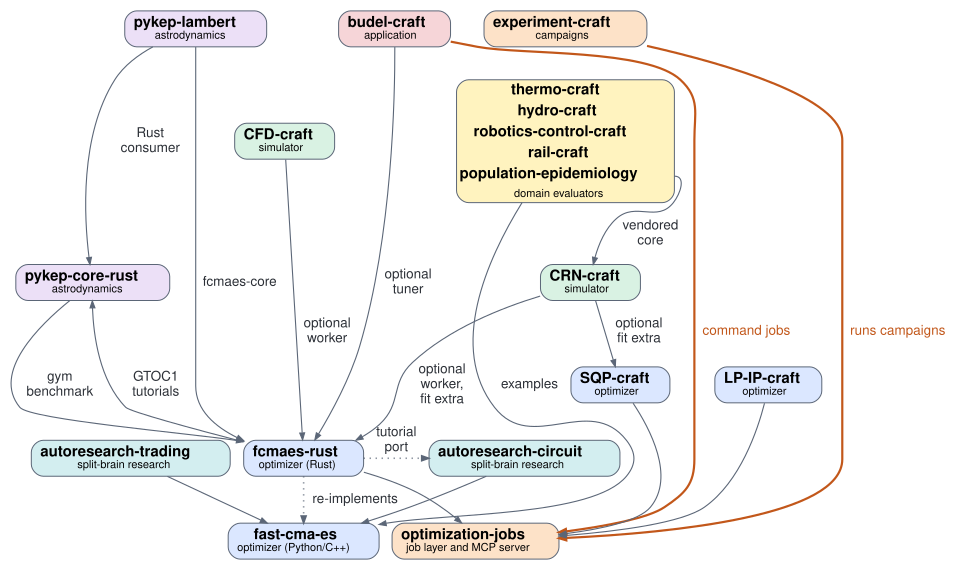

# Recent GitHub repositories of dietmarwo

This overview covers 18 public repositories (forks excluded): the 16 with
default-branch commits since 1 August 2026 and two earlier split-brain
research projects from April 2026. Status: 6 November 2026; the CRN-craft
and population-epidemiology entries as of 8 November 2026.

Together they connect Python and Rust optimizers, durable job execution,
experiment campaigns, simulators and bounded domain models. Native
evaluators keep the cost per evaluation low, and budgets, model hashes and
evidence records make the evaluations usable in repeatable campaigns.
Integration varies by component: some projects depend directly on numerical
crates, others provide optional workers or run as trusted commands, and
some connections are examples or ports. The shared
[ecosystem page](https://dietmarwo.github.io/optimization-jobs/) and
[solver-selection guide](https://github.com/dietmarwo/optimization-jobs/blob/main/ai-context.md)
are linked prominently from the four optimizer repositories and
optimization-jobs.

| Group | Repositories |
|---|---|
| 1. Optimizers | [fast-cma-es](#1-fast-cma-es), [fcmaes-rust](#2-fcmaes-rust), [LP-IP-craft](#3-lp-ip-craft), [SQP-craft](#4-sqp-craft) |
| 2. Running optimization for agents | [optimization-jobs](#5-optimization-jobs), [experiment-craft](#6-experiment-craft) |
| 3. Split-brain research loops | [autoresearch-trading](#7-autoresearch-trading), [autoresearch-circuit](#8-autoresearch-circuit) |
| 4. Simulators | [CRN-craft](#9-crn-craft), [CFD-craft](#10-cfd-craft) |
| 5. Astrodynamics | [pykep-core-rust](#11-pykep-core-rust), [pykep-lambert](#12-pykep-lambert) |
| 6. Domain evaluators | [thermo-craft, hydro-craft, robotics-control-craft, rail-craft, population-epidemiology](#6-domain-evaluators) |
| 7. Application | [budel-craft](#18-budel-craft) |

## Where to start

| If you have | Start with |
|---|---|
| An objective written in Python | [fast-cma-es](#1-fast-cma-es) |
| An objective written in Rust, or an expensive simulation with few evaluations | [fcmaes-rust](#2-fcmaes-rust) |
| A linear or mixed-integer model | [LP-IP-craft](#3-lp-ip-craft) |
| A smooth constrained model with derivatives and at most 256 variables | [SQP-craft](#4-sqp-craft) |
| Solver runs that must be durable, or an AI agent that drives them over MCP | [optimization-jobs](#5-optimization-jobs) |
| Parameter sweeps or solver comparisons with reports | [experiment-craft](#6-experiment-craft) |

## How they connect

Solid arrows are code dependencies; their labels say when a dependency is
optional. Thick orange arrows mean that a project runs its work through the
optimization-jobs command line. Dotted arrows mark a port or
re-implementation. The unlabelled arrows into optimization-jobs come from
the job-worker crates of the three solvers; their core libraries do not
depend on the job layer. The two links between fcmaes-rust and
pykep-core-rust are a tutorial and a benchmark tool, not dependencies
between the numerical cores.

The diagram is drawn with Graphviz from [images/repositories.dot](images/repositories.dot) (`dot -Tsvg repositories.dot -o repositories.svg`).

## 1. Optimizers

### 1. fast-cma-es

**The original fcmaes library for Python, with C++ cores.**
[github.com/dietmarwo/fast-cma-es](https://github.com/dietmarwo/fast-cma-es)

Gradient-free optimization: CMA-ES, differential evolution, BiteOpt and
other algorithms, parallel retry, multi-objective search (MODE) and quality
diversity, with many application tutorials. Published on PyPI as `fcmaes`
(2.1.0); the longest-established project here, with 164 GitHub stars on
6 November 2026. It remains the recommended choice for objectives written
in Python, because it evaluates them in parallel with multiprocessing.

**Relations:** fcmaes-rust re-implements its algorithms in Rust. Both
autoresearch projects use it as their inner optimizer, and the five domain
evaluators use it in their Python optimization examples. Its Water/HBV
tutorial is the origin of hydro-craft.

### 2. fcmaes-rust

**An independent native Rust implementation of the fcmaes algorithm family.**
[github.com/dietmarwo/fcmaes-rust](https://github.com/dietmarwo/fcmaes-rust)

Black-box, multi-objective and quality-diversity optimizers in the crate
`fcmaes-core` (0.2.1), which does not compile, link or call the original
C++ code and has no job-layer dependency. Python bindings are on PyPI as
`fcmaes-rust`; they fit best when the objective itself is in Rust. The
optional, source-built `fcmaes-job-worker` serves optimization-jobs and
offers an experimental exact-GP surrogate profile for expensive
simulations with few evaluations. Its 22 tutorials range from GTOC1
trajectory design to truss sizing, lens design, robot gaits and other
simulator-backed problems, and its GTOP benchmarks compare it with the
original.

**Relations:** the job worker depends on the optimization-jobs crates.
CRN-craft and CFD-craft build their optional workers on it. budel-craft,
pykep-lambert and the pykep-core-rust gym benchmark use `fcmaes-core`. The
two GTOC1 tutorials use `pykep-core` 0.1.5. The oscillator-topology-search
tutorial is a Rust port and extension of autoresearch-circuit, and the
GTOC1 route search applies the same split-brain pattern to planet orders.

### 3. LP-IP-craft

**Native Rust LP/MIP solver.**
[github.com/dietmarwo/LP-IP-craft](https://github.com/dietmarwo/LP-IP-craft)

Linear and mixed-integer linear optimization with Python bindings
(`lp-ip-craft` 0.29.0) and a separate job worker for shell or MCP jobs.
Nine application tutorials cover allocation, battery dispatch, Sudoku,
rostering, transportation, facility location, cutting stock, stochastic
planning and the ESA SpOC 4 matching tables, each checked against an
independent reference.

**Relations:** its job worker depends on the optimization-jobs crates. The
shared guide routes linear and integer problems here instead of to fcmaes.

### 4. SQP-craft

**Sequential quadratic programming for smooth constrained problems.**
[github.com/dietmarwo/SQP-craft](https://github.com/dietmarwo/SQP-craft)

A dense-BFGS SQP solver in Rust with Python bindings (`sqp-craft` 0.17.0)
and a separate job worker, for problems with derivatives and at most 256
variables, such as trajectory transcriptions. Tutorials range from
constrained calibration and collocation to a low-thrust transfer, an
Earth–Mars Sims–Flanagan leg, reaction kinetics and AC power dispatch.

**Relations:** its job worker depends on the optimization-jobs crates.
CRN-craft's optional fitting extra pairs a global fcmaes-rust search with
local SQP-craft refinement.

## 2. Running optimization for agents

### 5. optimization-jobs

**The shared job layer and MCP server for the solvers.**
[github.com/dietmarwo/optimization-jobs](https://github.com/dietmarwo/optimization-jobs)

Durable, versioned solver jobs for agents and people: a strict job
envelope, a result contract with claims and evidence, a worker SDK, the
runner `optimization-run`, which admits jobs against the CPU budget of its
node, and `optimization-mcp`, an MCP server that offers the registered
solver workers as tools. The command line also runs opt-in trusted command
jobs and checked binary file transfers, which the MCP server refuses, and
places jobs explicitly on registered SSH nodes. Remote launch needs a
systemd user manager with lingering on the node. It contains no solver or
simulator of its own, and it hosts the shared solver-selection guide and
the ecosystem page. Version 0.4.0; the solver repositories pin it by Git
revision.

**Relations:** fcmaes-rust, LP-IP-craft and SQP-craft provide job workers
built on its API. experiment-craft drives it through the command line,
budel-craft runs as a trusted command job, and CRN-craft and CFD-craft are
listed as simulation models.

### 6. experiment-craft

**Reproducible campaigns, parameter sweeps and solver comparisons.**
[github.com/dietmarwo/experiment-craft](https://github.com/dietmarwo/experiment-craft)

A source-installed Python package (0.4.0) that composes ordinary
optimization jobs into campaigns: parameter sweeps, dependent checks and
scientific comparisons with reports, plus a local browser dashboard.
optimization-jobs owns execution, admission, staging, supervision and
recovery; experiment-craft owns campaign composition, scientific choices
and reports. Local acceptance uses the real runner and three real Rust
workers; automatic placement and real-host commissioning are still gated.

**Relations:** runs entirely through the optimization-jobs command line
and its solver workers.

## 3. Split-brain research loops

Both projects split a design problem at the same seam. An outer search,
often an LLM agent, proposes the discrete structure, and fcmaes searches
that structure's continuous parameters under a declared budget before it
is scored. This reduces the dependence on arbitrary parameter guesses;
comparisons still depend on the search budget, seeds, simulation fidelity
and validation design.

### 7. autoresearch-trading

**LLM-designed trading strategies with fcmaes parameter tuning.**
[github.com/dietmarwo/autoresearch-trading](https://github.com/dietmarwo/autoresearch-trading)

An agent loop inspired by Karpathy's autoresearch. A local or hosted LLM
(an OpenAI-compatible server, or the Claude or Gemini APIs) writes the
strategy logic: indicators, entry and exit rules and position sizing.
fcmaes (BiteOpt) tunes the strategy's parameters on Numba-compiled
backtests, and walk-forward validation on rolling out-of-sample windows
returns one score to the agent. Because that score steers the agent, the
windows become part of development; a final judgment needs data the loop
has not used. Ships cached equity and crypto price histories and the logged
results of several models. Python package 0.1.4, MIT license.

**Relations:** the first split-brain project. It uses the Python `fcmaes`
package from fast-cma-es, and autoresearch-circuit is its sister project.

### 8. autoresearch-circuit

**Split-brain design of stochastic biochemical circuits.**
[github.com/dietmarwo/autoresearch-circuit](https://github.com/dietmarwo/autoresearch-circuit)

The outer loop proposes gene-regulatory topologies under a grammar, by
random, evolutionary or LLM-guided agentic search. For each topology fcmaes
tunes the kinetic parameters, GillesPy2 simulates the stochastic model and
scores oscillation quality, and a final validation applies seed, knockout,
knockdown and parameter-jitter tests. Two presets: a 3-gene oscillator and
a knockout-robust 5-gene oscillator. Closely related to the CircuiTree
paper by Bhamidipati and Thomson. Python package 0.1.1, MIT license.

**Relations:** uses the Python `fcmaes` package. fcmaes-rust's
oscillator-topology-search tutorial ports it to Rust and extends it.
CRN-craft provides this kind of stochastic simulation natively in Rust and
compares itself with GillesPy2.

## 4. Simulators

### 9. CRN-craft

**Chemical reaction network simulation in native Rust.**
[github.com/dietmarwo/CRN-craft](https://github.com/dietmarwo/CRN-craft)

Exact stochastic simulation (Direct, next reaction and related SSA
variants), sparse finite state projection and explicitly approximate
Poisson leaps. An experimental rule-based engine simulates species that
appear and disappear, such as mtDNA clones; since 0.3.0 it also handles
continuous variables through an approximate `hybrid` method with declared
tolerances. Optional integrations add BDF integration with forward
sensitivities, fcmaes job applications, global-to-SQP fitting and
SBML/BioNetGen import subsets; the default Rust engine depends on none of
them. Available as `crn-craft` on PyPI, with pandas results and, since
0.5.0, paths and event columns as xarray arrays, and as the crates
`crn-craft`, `crn-craft-rules` and `crn-craft-cli` (0.5.0). Four
optimization lessons cover stochastic calibration and inference.

**Relations:** its optional job integration builds on fcmaes-rust's job
worker, and the optional `fit` extra installs fcmaes-rust and sqp-craft.
population-epidemiology depends on the `crn-craft` crate. Listed as a simulation model on
the optimization-jobs page.

### 10. CFD-craft

**CFD experiment and validation workbench.**
[github.com/dietmarwo/CFD-craft](https://github.com/dietmarwo/CFD-craft)

A native Rust solver for incompressible flow and passive gas dispersion, a
bounded OpenFOAM 13 backend for comparison runs, and a Python API
(`cfd-craft` 0.1.0 on PyPI, plus the crates `cfd-craft` and
`cfd-craft-cli`). It includes numerical verification and bounded reference
comparisons. Version 0.1.0 is a research prototype: physical qualification
of the native street-canyon model is incomplete.

**Relations:** the optional `fcmaes-cfd-worker`, built outside the main
workspace, uses fcmaes-rust's job worker. Listed as a simulation model on
the optimization-jobs page.

## 5. Astrodynamics

### 11. pykep-core-rust

**Pure-Rust astrodynamics ported from ESA's pykep 3.**
[github.com/dietmarwo/pykep-core-rust](https://github.com/dietmarwo/pykep-core-rust)
· [documentation](https://dietmarwo.github.io/pykep-core-rust/)

Lambert solvers, Kepler and adaptive Taylor propagation, ephemerides,
flybys, Sims–Flanagan and zero-order-hold low-thrust legs, and a trajectory
gym with multiple-gravity-assist and low-thrust benchmark problems. Released
as the crate `pykep-core` and the Python wheel `pykep-rust` (0.1.5). The
wheel includes the gym; its Rust crate `pykep-trajopt` is built from source
and not published. Also includes an astrodynamics introduction for
programmers and benchmarks against PyKEP and heyoka.

**Relations:** fcmaes-rust's GTOC1 tutorials use `pykep-core`, and its gym
benchmark tool uses `fcmaes-core`. pykep-lambert consumes it.

### 12. pykep-lambert

**Fast Lambert transfer tables for the ESA SpOC 4 competition.**
[github.com/dietmarwo/pykep-lambert](https://github.com/dietmarwo/pykep-lambert)

A Numba port of pykep's Izzo Lambert solver that builds large transfer
tables in parallel, benchmarked against original pykep and the `pykep-rust`
wheel. It also contains a native Rust consumer.

**Relations:** the Rust consumer pins `pykep-core` 0.1.3 and `fcmaes-core`
0.1.3, which makes it an early downstream user of both.

## 6. Domain evaluators

Five small, bounded evaluators that turn a domain model into a fast
objective function for optimizers and agents. Each is written in Rust with
Python bindings and a versioned JSON CLI (`describe`, `run`) with exact
model hashes and explicit work limits. In Python, `Prepared.score_matrix`
scores many parameter rows in one native call, without per-candidate JSON.
Each also has a model card, a tutorial, optimization examples with SciPy
and fcmaes, and performance logs. All are at 0.3.0; their wheels are in each
repository's `packages/` folder and are not on PyPI.

| # | Repository | Domain | Model |
|---|---|---|---|
| 13 | [thermo-craft](https://github.com/dietmarwo/thermo-craft) | Thermodynamics | IAPWS-IF97 water and steam properties (regions 1, 2 and 4); a fixed steam Rankine cycle, simple or with two open feedwater heaters |
| 14 | [hydro-craft](https://github.com/dietmarwo/hydro-craft) | Hydrology | Synthetic HBV-style daily catchment and a one-reservoir release rule |
| 15 | [robotics-control-craft](https://github.com/dietmarwo/robotics-control-craft) | Control | Mass–spring–damper with held-force schedules and sampled saturated PD controllers |
| 16 | [rail-craft](https://github.com/dietmarwo/rail-craft) | Rail operations | Dispatch policies on synthetic fixed-route corridors with blocking, clearance and entry closures |
| 17 | [population-epidemiology](https://github.com/dietmarwo/population-epidemiology) | Epidemiology | Fixed-population SIR via finite state projection, neutral Moran drift and two-state rate calendars |

**Relations:** their optimization examples use the Python `fcmaes` package
from fast-cma-es. hydro-craft grew out of the fast-cma-es Water/HBV
tutorial, and population-epidemiology depends on the `crn-craft` crate (its
0.3.0 packages carry a vendored copy of the core). They have
no dedicated optimization-jobs workers.

## 7. Application

### 18. budel-craft

**2D irregular nesting.**
[github.com/dietmarwo/budel-craft](https://github.com/dietmarwo/budel-craft)

A native Rust solver that packs polygons into a rectangular sheet, with
optional or mandatory stock, and exports placement JSON (0.2.0).

**Relations:** the optional `fcmaes` feature adds a policy tuner (DE,
BiteOpt, random search) and an experimental DE neighborhood operator,
based on `fcmaes-core` 0.1.3. It runs as a trusted command job through the
`optimization-run` command line, exercised with optimization-runner 0.4.0.

## Not included

Older repositories such as FastGaussianPuffOpt, drq_fast_mars and
fcmaes-java, and all forks.
