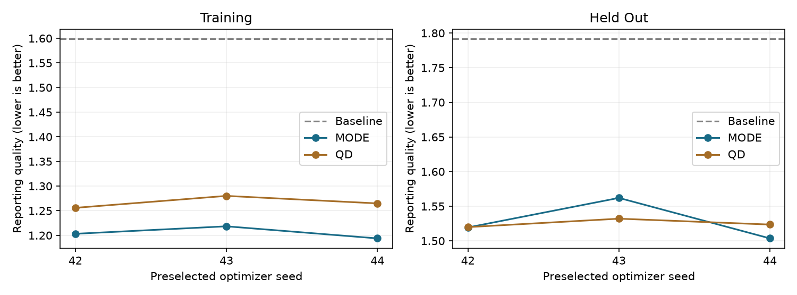
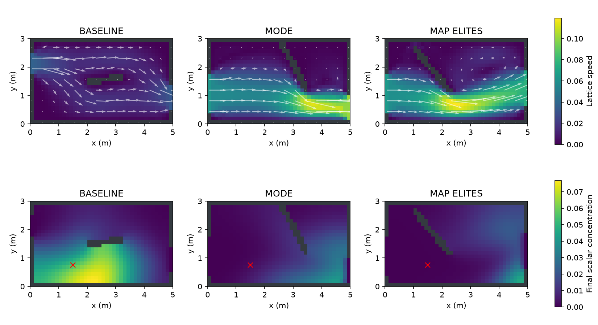
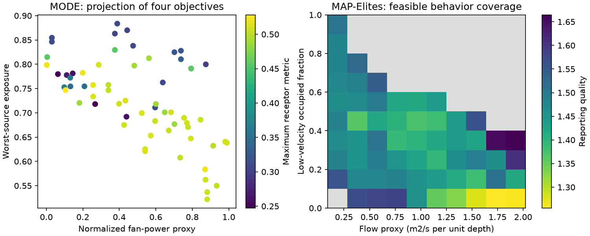
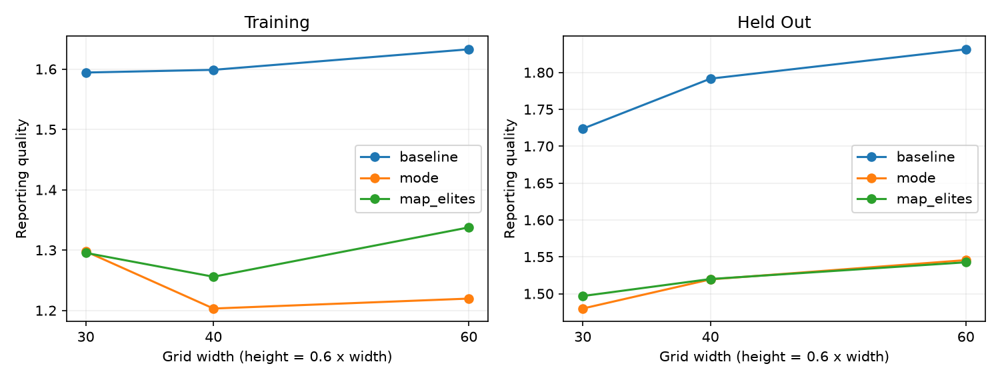

# Fluid dynamics through prompts

## Optimize a design, then challenge the CFD result

A workshop for a fluid dynamics engineer who wants an AI agent to help run and audit simulation-based design studies. The example is ventilation in a two-dimensional room: change the vents and a baffle to reduce pollutant exposure while accounting for flow and fan effort. The transferable skill is a reproducible engineering conversation with an agent.

The agent organizes experiments, calls the existing native Rust simulator and optimizers, checks exported results, and explains the trade-offs. You retain responsibility for the physical model, objective definitions and engineering decision. The reader works through prompts; executable setup and audit code are supplied separately.

**The measured lesson:** both optimizers improved this educational model. Their selected designs looked closer to each other on unseen release locations than on the training cases. Grid/setup changes also affected the scores. A better optimization score is only one part of the evidence.

## Start with this prompt

Prepare the environment using [SETUP.md](SETUP.md). Give a shell-capable agent the repository, executable and output paths, then paste this opening. [prompt.md](prompt.md) contains the full experiment contract.

> Act as my simulation-optimization colleague. Read the existing fcmaes-rust room-ventilation model and its backend description. State the design variables, units, objectives, constraints and physical limitations before execution. Use the native CLI and supplied orchestration script.
>
> Compare MODE and MAP-Elites with seeds 42, 43 and 44, 2,048 search evaluations per method and seed, and two workers. Keep the 40 by 24 grid, 800 maximum flow steps and 600 scalar steps. Preserve all outputs and failures. Select representatives on training cases only; evaluate the unchanged designs on the three held-out pollutant-release locations.
>
> Preselect seed 42 for field plots and the existing three-grid verification study. Check the channel reference, constraint margins, actual evaluation counts, exported decisions and objective components. Distinguish optimizer progress, iterative convergence, grid/setup sensitivity, unseen scenarios and physical validation. Return an engineering note, figures and exact artifact paths.

Use a capable agent with terminal access. These prompts are provider independent. The numerical experiment needs no model API key. This CFD tutorial currently exposes a native CLI; it has no registered optimization-jobs worker profile.

<!-- pagebreak -->

## Freeze the engineering question

The existing model is a 5 m by 3 m room with an inlet on the left wall, an outlet on the right, and one internal baffle. A D2Q9 lattice-Boltzmann flow model supplies velocity to a D2Q5 passive-scalar transport model. Geometry is rasterized on the grid. This small, two-dimensional model is useful for learning the workflow; its fan-power and pressure outputs are proxies.

| Decision group | Variables and bounds |
|---|---|
| Vent centers | Inlet and outlet vertical position / room height: 0.12 to 0.88 |
| Vent openings | Inlet and outlet opening height / room height: 0.12 to 0.45 |
| Inlet speed | 0.25 to 1.50 m/s in the model's input convention |
| Baffle center | x / room width: 0.20 to 0.80; y / room height: 0.15 to 0.85 |
| Baffle shape | Length / room height: 0.15 to 0.65; angle: -1.40 to 1.40 radians |

Each candidate uses one flow solution and three pollutant releases. For each pollutant metric, optimization uses the worst source result; the worst source need not be the same for every metric. Release coordinates are fractions of room width and height.

| Scenario set | Release locations (x, y) |
|---|---|
| Training | (0.72, 0.30), (0.30, 0.25), (0.58, 0.55) |
| Held out | (0.22, 0.48), (0.48, 0.36), (0.78, 0.52) |

MODE minimizes four objectives: integrated occupied-zone exposure, maximum receptor concentration, normalized fan-power proxy, and final pollutant mass fraction. MAP-Elites fills a 10 by 10 archive indexed by flow and low-velocity occupied fraction, keeping a good feasible design in each occupied cell.

For reporting and representative selection, the feasible scalar is **exposure + 0.5 × receptor + 0.2 × fan proxy + 0.5 × final mass**. MODE still searches in four objective dimensions. The native scalar adds a penalty to infeasible designs; do not compare that penalized value as if it were a feasible engineering metric.

The model requires flow of at least 0.18 m²/s per unit depth, both baffle endpoints one cell inside the room, flux mismatch at most 5%, and flow residual at most 0.0005. These numerical acceptance limits do not establish physical accuracy. Clearance time is a diagnostic capped by the finite simulation horizon, not an optimized objective or evidence of complete clearance.

<!-- pagebreak -->

## Measured results across three fixed seeds

The table reports the selected designs' scalar quality; lower is better. Means and sample standard deviations use all three predeclared seeds. Baseline values come from the repeated 40 by 24 evaluation. Search budgets are equal, while baseline, held-out and verification evaluations are additional work.

| Method | Training mean | Training SD | Held-out mean |
|---|---:|---:|---:|
| Baseline | 1.59871 | — | 1.79153 |
| MODE | 1.20505 | 0.01237 | 1.52834 |
| MAP-Elites | 1.26689 | 0.01225 | 1.52516 |

Held-out sample standard deviations were 0.03023 for MODE and 0.00624 for MAP-Elites. The mean held-out improvement over this baseline was about 14.7% and 14.9%, respectively. Those percentages describe this model and these release locations; they do not measure real-world pollutant reduction.

MODE's better training scalar did not establish a better held-out result: MAP-Elites was slightly better on the three-seed held-out mean. The difference is small, and three seeds are a pilot rather than evidence for a general solver ranking. The methods also serve different purposes: a trade-off set versus a repertoire of behaviors.

All six selected designs met the four model constraints on training and held-out replay. The script checked each raw constraint vector and verified that the exported held-out decision vector matched the training-selected vector. Unseen releases never selected or retuned a design.

> Explain why a lower training score did not produce a clear held-out winner. Show every seed and all objective components. Separate optimizer randomness from the limited coverage of six specified release locations; do not attach a confidence claim to those locations as if they were a sampled operating distribution.

<!-- pagebreak -->

## Read the fields and the energy trade-off

Seed 42 was fixed as the representative before examining results. The figure shows velocity magnitude and final scalar concentration for the baseline and the two selected designs. Each row uses a common color scale. Gray cells are solid boundaries/baffles; red crosses mark the actual release locations. Each scalar field uses that design's worst-exposure training source, which need not be identical across designs.

| Design, seed 42 | Exposure | Receptor | Fan proxy | Final mass |
|---|---:|---:|---:|---:|
| Baseline | 0.83522 | 0.52083 | 0.06603 | 0.97975 |
| MODE | 0.65310 | 0.51210 | 0.57247 | 0.35890 |
| MAP-Elites | 0.58307 | 0.50969 | 0.62574 | 0.58548 |

Both selected designs spend substantially more fan effort in the proxy than the baseline. MODE retains less final pollutant mass; MAP-Elites has lower integrated exposure in this representative training comparison. A single weighted score hides that choice. The velocity color bar is in lattice units, and the scalar is normalized model concentration; neither is a calibrated building measurement.

> Inspect the inlet jet, recirculating regions and pollutant retention. Explain the four metrics together. Propose an energy-constrained shortlist from the retained alternatives, and identify which additional held-out replays it needs. Keep physical explanations as hypotheses until supported by a suitable model or experiment.

<!-- pagebreak -->

## Ask for alternatives, not just one geometry

The seed-42 MODE run retained 64 non-dominated points in four objective dimensions. The left panel is a projection: exposure versus fan proxy, colored by receptor metric. Final mass is omitted from the picture but remains in the CSV and the dominance check. A point that looks worse in this projection may be useful in the full objective space.

The seed-42 MAP-Elites run filled 60 of 100 behavior cells; the other seeds filled 65 and 62. The right panel shows the best retained feasible quality per occupied cell. Gray cells are unfilled, which does not prove that their behaviors are impossible. Archive coverage is a different outcome from the best reporting scalar.

> Produce a shortlist of three geometries with distinct fan-effort, exposure and low-velocity behavior. Show the nine design variables, four objectives and constraint margins. Use the full four-dimensional MODE data and the MAP-Elites archive, not only this projection. State which candidates have been replayed on unseen sources and which still need that work.

The supplied campaign validates held-out performance only for each run's selected representative. It does not establish held-out performance for every retained alternative. If the shortlist changes after inspecting the archive, allocate new assessment runs and record that decision.

For an expensive production CFD case, thousands of evaluations may be unaffordable. Start with the actual wall-time and parallelism budget. A surrogate-assisted strategy can be an appropriate separate experiment when its assumptions and constraints fit. Smooth, differentiable cases may favor gradients or adjoints. This workshop does not establish one optimizer as the right choice for all CFD problems.

<!-- pagebreak -->

## Challenge the numerical evidence

The verification executable replays the baseline and unchanged seed-42 designs at 30 by 18, 40 by 24 and 60 by 36, on both source sets: 18 comparisons. All were feasible under the model's limits. The repeated 40 by 24 metrics matched the original selected results within 0.00000001.

This is a **grid/setup sensitivity study**. The native backend keeps lattice relaxation times and the conversion from inlet input speed to lattice speed fixed. The runs do not establish a constant physical or nondimensional flow/scalar problem under refinement. Geometry rasterization and step budgets change too. Therefore, no formal convergence order, Richardson extrapolation or grid-convergence index is reported.

At 60 by 36, training quality was 1.21958 for MODE and 1.33759 for MAP-Elites; held-out quality was 1.54549 and 1.54254. Both still improved on the baseline in this study. Their flow residuals were 0.000481 and 0.000475, close to the 0.0005 limit. A passing residual threshold deserves inspection of its margin.

The straight-channel check produced a maximum-to-mean axial velocity ratio of 1.49236, symmetry error below 0.0000000001, flux mismatch 0.00414 and residual 0.000000990. These are useful numerical sanity checks. They do not validate turbulent room ventilation, physical diffusivity, three-dimensional effects or real exposure predictions.

> Before a controlled refinement study, establish the physical/nondimensional parameters, geometry, boundary conditions, observation horizon and iterative tolerances that must remain consistent. Then propose separate code/solution-verification and experimental-validation work. Do not treat agreement from the same implementation as independent physical validation.

<!-- pagebreak -->

## Transfer the conversation to your own CFD case

Keep the experiment discipline and replace the teaching kernel with a case whose physics and validation are appropriate to your decision. The same questions apply to a duct, cooling channel, pump, mixing device or other design. An adapter to your chosen solver is additional engineering work.

| Contract item | What to settle before optimization |
|---|---|
| Geometry and mesh | Parameterization, valid geometry, mesh quality and reproducible regeneration |
| Physics | Fluid properties, boundary conditions, turbulence/transport assumptions, units and applicable validation evidence |
| Evaluation result | Objectives, raw constraint margins, convergence history and explicit failed-run status |
| Budget and resources | Cost per case, concurrent cases, threads per solver and time limits |
| Assessment | Frozen candidates, reserved scenarios, controlled grid/time studies and reference measurements |
| Engineering decision | Acceptable trade-offs, manufacturability, uncertainty and the reviewer who owns the choice |

> Inspect the validated case and executable interface I provide. Map the design variables, meshing, boundary conditions, convergence criteria, failures and objective extraction into an experiment contract. Choose a small pilot budget and an assessment plan before recommending an optimizer. Explain what the available evidence can support.

More prompts, including a German opening, are in [follow-up-prompts.md](follow-up-prompts.md). Exact setup and rerun commands are in [SETUP.md](SETUP.md).

## What was actually tested

The final campaign executed six native searches with **12,288 search evaluations**, plus verification. A separate smaller CI campaign executed two searches with 1,024 search evaluations and the same audit path. Thirteen existing native tests and three new artifact-audit tests passed; stable Rust Clippy, documentation checks and workflow lint also passed. The model and Rust dependency pins were unchanged.

These are executed CLI experiments and code tests. No fresh-context model trial was performed. The agent prompts are a reproducible way to request the work; the numerical results come from native runs, not language-model estimates. [VALIDATION.md](VALIDATION.md) and [validation.json](validation.json) record the checks and measured data.

## Sources and technical entry points

[1] The maintained [native tutorial](https://github.com/dietmarwo/fcmaes-rust/tree/main/tutorials/cfd-room-ventilation) and [backend description](https://github.com/dietmarwo/fcmaes-rust/blob/main/tutorials/cfd-room-ventilation/BACKEND.md) define the model used here.

[2] NASA/NPARC, [Examining Spatial (Grid) Convergence](https://www.grc.nasa.gov/www/wind/valid/tutorial/spatconv.html) and [Validation Assessment](https://www.grc.nasa.gov/www/wind/valid/tutorial/valassess.html), accessed 23 October 2026, provide background for the distinction between refinement evidence and agreement with physical measurements.

All figures and workshop measurements here were computed for this tutorial. This educational model is not a calibrated ventilation design or health-assessment tool.
