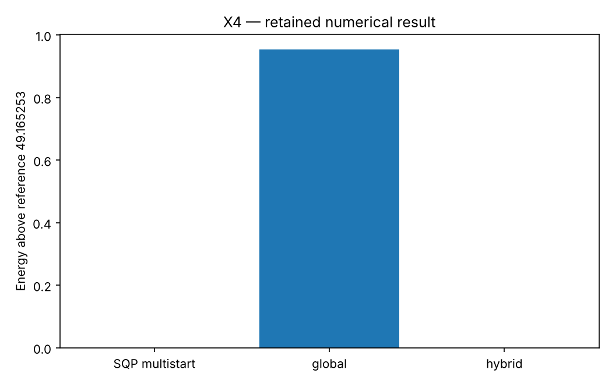

# X4: Points on a sphere: global and local search

This chapter runs native Rust solvers through their Python APIs. Its model and independent checks live in this directory; the shared driver in optimization-jobs adds figures and command-job execution.

## Model and decision

Thomson energy sums 1/distance over every pair of unit-sphere charges. SQP uses Cartesian equality constraints; BiteOpt normalizes triples before evaluating the same energy. Compare three local starts, global search and a declared global/local split.

## Work through the lesson

Minimize Coulomb energy

$$E(x)=\sum_{i<j}\frac1{\|x_i-x_j\|},\qquad\|x_i\|^2=1.$$

SQP uses Cartesian coordinates and sphere equalities. The black-box arm normalizes triples onto the sphere before evaluating the same energy.

1. Compare three SQP starts, a global Bite search, and a declared global-then-local split. Smoke uses 12 charges and the icosahedral reference 49.165253058; study uses 60 charges and putative reference 1543.830401.
2. Read each arm's actual search pair interactions. A shared maximum number of callbacks does not imply equal consumed work; early convergence and partial evaluations change counts. Derivative and Hessian audits are outside these arm counts.
3. Compare only independently checked sphere points. If a local attempt is infeasible, retain its raw native result and audit, then explicitly project it onto the sphere and recompute its feasible energy without transferring a first-order claim. Projection/check work is outside the reported search counters. A small raw objective at an infeasible point is not an improved Thomson solution.
4. Compute a finite-difference Lagrangian Hessian projected onto the sphere tangent space only when an accepted point passes the independent first-order check. Otherwise `hessian_status` records why curvature classification was not run. `curvature` records the verdict with a relative tolerance: three near-zero rotational modes and positive remaining curvature give `local_minimum`, a negative eigenvalue `not_a_local_minimum`, anything else `inconclusive`. A converged attempt that fails the independent first-order check is kept and flagged (`converged_without_independent_first_order`); it does not stop the other arms.
5. Matching a published putative reference is not a proof of global optimality. Different formulations and global/local splits remain descriptive comparisons.

## Run

Install the pinned solver packages and scientific dependencies as described in the [shared setup](https://github.com/dietmarwo/optimization-jobs/blob/main/tutorials/structured/README.md), with the repositories it lists cloned side by side. From this repository's root:

```bash
python ../optimization-jobs/tutorials/structured/run.py --chapter X4 --output /absolute/new/x4
```

To run the chapter on its own, use `python tutorials/thomson-refinement/run.py --preset smoke --output /absolute/new/x4-direct`. It produces JSON; the shared driver additionally renders PNG/SVG figures. `--preset study` runs the larger declared cases; a chapter without them repeats the smoke case. Output may be new or empty, and an occupied directory is refused.

## Independent answer and validation

Smoke uses 12 charges, with the icosahedral reference 49.1652530576; study uses 60. Every pair interaction of the searches is counted in `search_pair_traversals`; the projection, derivative and Hessian audits are not counted there. A finite-difference Lagrangian Hessian is projected into the tangent space.

Every run keeps the native status, points and available diagnostics. Application-specific references are computed separately. All failures remain in the report.

## Read the result

Read `summary.json` before interpreting `figure.png`. The report records the actual result; expected reference values are not substituted for missing numerical outcomes. A completed command job means that the chapter's executable checks completed, while individual solver attempts can still be nonconvergent where the lesson explicitly retains them.

The arms share requested callback caps, not identical consumed work or wall time. Reaching a published putative minimum is not a global certificate. Invalid collision candidates are retained in the failure count.

## Agent prompt

> Compare SQP multistart, global search and hybrid refinement for the sphere-charge fixture. Report actual pair work and native failures. Rank only checked sphere energies, withhold first-order claims from projected fallbacks, and classify curvature only at a verified stationary point.

Use the complete [prompt](prompt.md) for the workflow and evidence requirements.

## Follow-up exercise

Compare callback caps with actual consumed pair work. Examine the rotational zero modes only at an accepted first-order point and avoid assuming every stationary point is a minimum.

## Provenance and limits

The checked-in `results/` record one run of each preset. The shared driver writes source and package identities to `environment.json` for the runs it makes. These are reproducible teaching experiments, not industrial or hardware performance certifications. Tables that compare formulations or solvers are descriptive.

## Recorded example



Inspect the [complete smoke summary](results/smoke/summary.json) alongside the figure.

The requested callback cap is 480 in smoke and 3,600 in study. Each of three local starts receives one third; the hybrid splits half to global search and half to local refinement. Every arm retains actual work and termination.

The [study summary](results/study/summary.json) and [study figure](results/study/figure.png) record the study preset.
