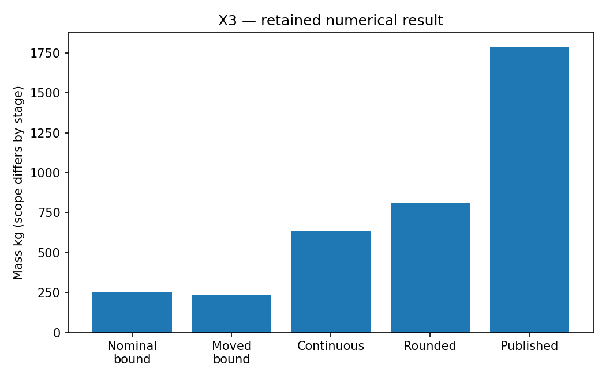

# X3: Truss design: bound, continuous sizing and catalogue

This chapter runs native Rust solvers through their Python APIs. Its model and independent checks live in this directory; the shared driver in optimization-jobs adds figures and command-job execution.

## Model and decision

Reuse the original 18-node/75-member ground geometry, loads and published moved design. A yield-only LP uses shared areas and separate force variables for two load cases. Smooth sizing on the published fixed topology adds stress, Euler buckling and displacement constraints.

## Work through the lesson

Use shared cross-sectional areas and separate member forces for both load cases in the yield-only LP. Force equilibrium is linear and $|f_{m\ell}|\le\sigma A_m$. Minimize $\rho\sum_mL_mA_m$.

1. Solve the nominal 18-node/75-member ground structure: yield-only bound 249.169953 kg. Repeat at the published moved geometry: 237.404401 kg. Each bound applies only to its own geometry and physics.
2. On the fixed published topology and moved geometry, size continuous hollow sections with inner/outer diameter ratio 0.8. Analytic FEM sensitivities are checked against finite differences. Keep the active-set attempt whatever it ends with. The recorded run stops with a QP failure at a feasible point, but its path follows the last digits of the FEM, so another processor's NumPy and OpenBLAS kernels can end it at the restoration limit at an infeasible point. The declared Clarabel attempt (also without internal Jacobian scaling) converges near 637.321752 kg on either path.
3. Round up to catalogue sections and recompute all responses. Rounding up redistributes forces in an indeterminate truss, so the chapter checks the rounded design against the stress, buckling and displacement limits again (`catalogue_rounding.feasible`) and fails if it does not pass. The retained 812.080766 kg design passes in the Python model, and the original Rust FEM replay accepts it under the tutorial's scalar constraint contract.
4. Recheck the original 1,789.319 kg published design with the original FEM too; the replay must report it feasible, with the same mass. These masses describe distinct geometry, section and physical scopes; the picture is not a certified decomposition of a single optimization gap. Both bounded LPs also run `safe_dual_bound`: the recorded statuses are `finite`, with bounds about 249.169953488352 and 237.404400836811 kg. The area cap is the largest catalogue section; the force cap is its yield load. These binary64 certificates apply to those bounded models. Plotting the virtual-displacement dual field remains an exercise.

## Run

Install the pinned solver packages and scientific dependencies as described in the [shared setup](https://github.com/dietmarwo/optimization-jobs/blob/main/tutorials/structured/README.md), with the repositories it lists cloned side by side. From this repository's root:

```bash
python ../optimization-jobs/tutorials/structured/run.py --chapter X3 --output /absolute/new/x3
```

To run the chapter on its own, use `python tutorials/truss-bounds/run.py --preset smoke --output /absolute/new/x3-direct`. It produces JSON; the shared driver additionally renders PNG/SVG figures. `--preset study` runs the larger declared cases; a chapter without them repeats the smoke case. Output may be new or empty, and an occupied directory is refused.

## Independent answer and validation

The nominal yield-only bound is about 249.17 kg. Recompute a separate bound at the moved geometry. Continuous FEM sensitivities pass finite differences; both the published and rounded catalogue designs are replayed through the original Rust FEM helper (`examples/structured_replay.rs`), which refuses designs the tutorial's decoder could not produce: moved supports or load nodes, offsets beyond the decoder's limits, repeated members, member counts outside 8–40 or unknown sections.

Every run keeps the native status, points and available diagnostics. Application-specific references are computed separately. All failures remain in the report.

## Read the result

Read `summary.json` before interpreting `figure.png`. The report records the actual result; expected reference values are not substituted for missing numerical outcomes. A completed command job means that the chapter's executable checks completed, while individual solver attempts can still be nonconvergent where the lesson explicitly retains them.

Every bound has a geometry/physics scope. The continuous section family fixes inner/outer diameter ratio to 0.8, a distinct model. The active-set attempt is retained whatever it ends with, and so is the successful Clarabel attempt.

## Agent prompt

> Explain the mass gap between a yield-only truss bound, continuous sizing, catalogue rounding and the published design. Keep geometry, section and physics scopes explicit, and verify catalogue designs with the original Rust FEM.

Use the complete [prompt](prompt.md) for the workflow and evidence requirements.

## Follow-up exercise

Change the geometry and explain why the old bound no longer applies. Inspect how continuous fixed-shape sections differ from actual catalogue sections and why rounding must be rechecked.

## Provenance and limits

The checked-in `results/` record one run of each preset. The shared driver writes source and package identities to `environment.json` for the runs it makes. These are reproducible teaching experiments, not industrial or hardware performance certifications. Tables that compare formulations or solvers are descriptive.

On another processor, NumPy and OpenBLAS select other vectorized kernels, so the FEM and the LP data change in their last digits. The bounds, the Clarabel sizing, the catalogue rounding and both replays still agree to about 1e-6. The active-set attempt can differ, and so can the LPs' duals and simplex work counters (the LPs are degenerate).

Build the original-FEM replay helper first and set its path:

```bash
cargo build --release --locked --manifest-path tutorials/truss-sizing/Cargo.toml --example structured_replay
export TRUSS_REPLAY_BIN="$PWD/tutorials/truss-sizing/target/release/examples/structured_replay"
```

A run without that variable records native FEM parity as `null`; the recorded results include it.

## Recorded example



Inspect the [complete smoke summary](results/smoke/summary.json) alongside the figure.

The [study summary](results/study/summary.json) and [study figure](results/study/figure.png) record the study preset.
